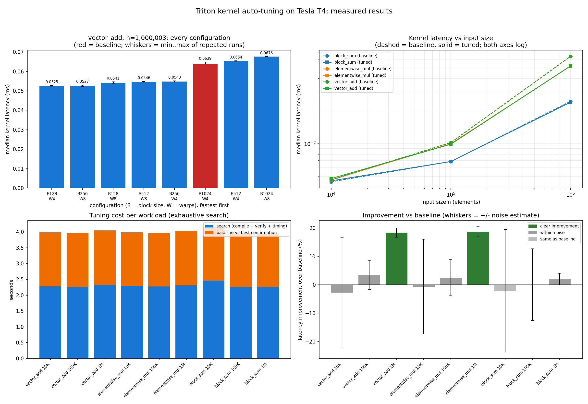

# Triton Kernel Auto-Tuning: Experiment Report

_Generated 2026-10-13T07:48:59. Every number below was measured on this GPU; nothing is simulated._

## 1. Setup

- GPU: Tesla T4 (14.56 GB, compute capability 7.5)
- PyTorch 2.11.0+cu130, Triton 3.6.0, Python 3.13.15
- Search algorithm(s): exhaustive. Search space: block size in [128, 256, 512, 1024] x num_warps in [4, 8]
- Timing: `triton.testing.do_bench` (CUDA events, L2 flushed), 25 ms warm-up and 50 ms measurement per run; 5 runs per config in the search (median reported); 15 interleaved runs per config in the final baseline-vs-best comparison
- Baseline: B1024_W4. Improvement % is relative to this choice only.
- Improvement (%) = (baseline latency - tuned latency) / baseline latency x 100, taken from the interleaved head-to-head re-measurement, not from the search phase (this avoids the winner's curse).
- The full sweep was repeated 3 times; section 4 shows whether the winner stayed the same.

## 2. Results (run 1)

| kernel | n | best (fastest tested) | baseline ms | tuned ms | improvement | noise | classification |
|---|---|---|---|---|---|---|---|
| vector_add | 10,000 | B256_W4 | 0.0046 | 0.0048 | -2.76% | 19.5% | within noise |
| vector_add | 100,000 | B128_W4 | 0.0102 | 0.0099 | +3.44% | 5.2% | within noise |
| vector_add | 1,000,003 | B128_W4 | 0.0638 | 0.0521 | +18.35% | 1.7% | clear improvement |
| elementwise_mul | 10,000 | B512_W8 | 0.0046 | 0.0046 | -0.69% | 16.7% | within noise |
| elementwise_mul | 100,000 | B128_W4 | 0.0102 | 0.0100 | +2.50% | 6.4% | within noise |
| elementwise_mul | 1,000,003 | B256_W8 | 0.0639 | 0.0520 | +18.64% | 1.8% | clear improvement |
| block_sum | 10,000 | B1024_W4 | 0.0044 | 0.0045 | -2.16% | 21.6% | same as baseline |
| block_sum | 100,000 | B256_W4 | 0.0068 | 0.0068 | +0.00% | 12.6% | within noise |
| block_sum | 1,000,003 | B512_W8 | 0.0246 | 0.0241 | +1.95% | 2.1% | within noise |

Classification rule: noise = max(spread of baseline runs, spread of tuned runs, 1%), where spread = (max - min) / median across repeated runs. `within noise` means |improvement| <= noise; `borderline` means up to 2x noise; `clear` means more than 2x noise.

**Summary:** of 9 workloads, 6 within noise, 2 clear improvement, 1 same as baseline.
Clear improvements: vector_add n=1,000,003 (+18.3%); elementwise_mul n=1,000,003 (+18.6%).
Small inputs (about 10K elements) run for only a few microseconds, so launch overhead and timer resolution dominate and differences there should not be interpreted as tuning gains.

## 3. Near-ties

`best_configurations.json` lists, for each workload, every configuration within 3% of the best search-phase latency. Several configurations are often indistinguishable, so the defensible claim is that a group of configurations is fast, not that one specific configuration is uniquely optimal.

## 4. Run-to-run stability of the winner

| kernel | n | runs | winner per run | improvement % per run | same winner every run |
|---|---|---|---|---|---|
| block_sum | 10,000 | 3 | B1024_W4, B512_W4, B512_W4 | -2.2, +0.0, +1.5 | no |
| block_sum | 100,000 | 3 | B256_W4, B256_W4, B512_W8 | +0.0, -0.5, +0.9 | no |
| block_sum | 1,000,003 | 3 | B512_W8, B512_W4, B512_W4 | +2.0, +1.7, +1.9 | no |
| elementwise_mul | 10,000 | 3 | B512_W8, B1024_W4, B1024_W4 | -0.7, -1.4, +5.3 | no |
| elementwise_mul | 100,000 | 3 | B128_W4, B1024_W4, B128_W4 | +2.5, +1.6, +2.8 | no |
| elementwise_mul | 1,000,003 | 3 | B256_W8, B128_W4, B128_W4 | +18.6, +18.3, +18.5 | no |
| vector_add | 10,000 | 3 | B256_W4, B256_W4, B1024_W4 | -2.8, +0.0, +1.4 | no |
| vector_add | 100,000 | 3 | B128_W4, B256_W8, B512_W4 | +3.4, +2.5, +0.6 | no |
| vector_add | 1,000,003 | 3 | B128_W4, B256_W8, B256_W8 | +18.3, +18.6, +18.2 | no |

9 of 9 workloads had a different winner in at least one run, which is expected when configurations are near-tied.

## 5. Tuning cost, cache reuse and amortization

| kernel | n | search s | confirmation s | cache hit total ms | kernel time saved per launch (us) | break-even launches |
|---|---|---|---|---|---|---|
| vector_add | 10,000 | 2.28 | 1.70 | 4.2 | -0.13 | n/a (no reliable saving) |
| vector_add | 100,000 | 2.27 | 1.70 | 3.3 | +0.35 | n/a (no reliable saving) |
| vector_add | 1,000,003 | 2.32 | 1.73 | 3.9 | +11.71 | 345,608 |
| elementwise_mul | 10,000 | 2.30 | 1.69 | 3.0 | -0.03 | n/a (no reliable saving) |
| elementwise_mul | 100,000 | 2.27 | 1.70 | 3.0 | +0.26 | n/a (no reliable saving) |
| elementwise_mul | 1,000,003 | 2.31 | 1.72 | 3.9 | +11.90 | 339,002 |
| block_sum | 10,000 | 2.46 | 1.69 | 3.0 | -0.10 | n/a (no reliable saving) |
| block_sum | 100,000 | 2.27 | 1.70 | 2.9 | +0.00 | n/a (no reliable saving) |
| block_sum | 1,000,003 | 2.27 | 1.68 | 2.9 | +0.48 | n/a (no reliable saving) |

Break-even = (search + confirmation time) / kernel time saved per launch, shown only for clear improvements. A cache hit reuses a stored configuration and runs one correctness launch; it does not produce a new benchmark measurement. Compile time is only partly included because Triton had cached some kernels earlier in the session.

## 6. Kernel latency vs end-to-end latency

| kernel | n | kernel baseline ms | kernel tuned ms | end-to-end baseline ms | end-to-end tuned ms | end-to-end / kernel (baseline) |
|---|---|---|---|---|---|---|
| vector_add | 10,000 | 0.0046 | 0.0048 | 0.0428 | 0.0426 | 9x |
| vector_add | 100,000 | 0.0102 | 0.0099 | 0.0423 | 0.0419 | 4x |
| vector_add | 1,000,003 | 0.0638 | 0.0521 | 0.1114 | 0.0976 | 2x |
| elementwise_mul | 10,000 | 0.0046 | 0.0046 | 0.1074 | 0.0653 | 23x |
| elementwise_mul | 100,000 | 0.0102 | 0.0100 | 0.0450 | 0.0428 | 4x |
| elementwise_mul | 1,000,003 | 0.0639 | 0.0520 | 0.1338 | 0.1261 | 2x |
| block_sum | 10,000 | 0.0044 | 0.0045 | 0.0467 | 0.0455 | 10x |
| block_sum | 100,000 | 0.0068 | 0.0068 | 0.0450 | 0.0449 | 7x |
| block_sum | 1,000,003 | 0.0246 | 0.0241 | 0.0845 | 0.0965 | 3x |

End-to-end latency includes output allocation, Python launch overhead and GPU synchronization, so it is larger than kernel latency and improves by a smaller percentage. It is a single median over 50 iterations without a spread estimate.

## 7. Limitations

- The selected configuration is the fastest among the valid configurations tested for the given kernel, size and GPU. It is not a proven global optimum.
- Improvement depends on the baseline chosen. A different baseline gives different percentages.
- Measurements come from one shared Colab T4. Clock changes and contention add noise, and results do not transfer to other GPUs (the cache key includes the GPU).
- Spread is a rough noise estimate, not a statistical confidence interval.
- Only float32, one-dimensional memory-bound kernels were tuned. The block-sum kernel tunes the per-block stage only; the final combination of partial sums is not part of the tuned kernel.
- Only block size and warp count are tuned.
